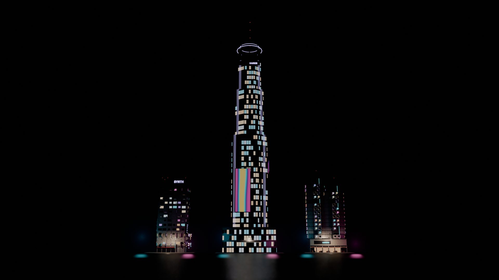
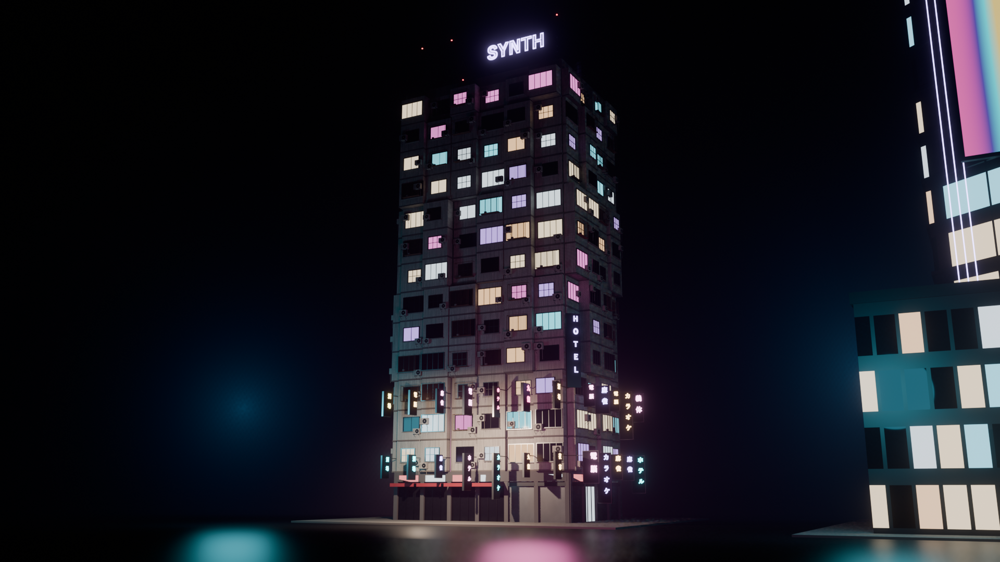
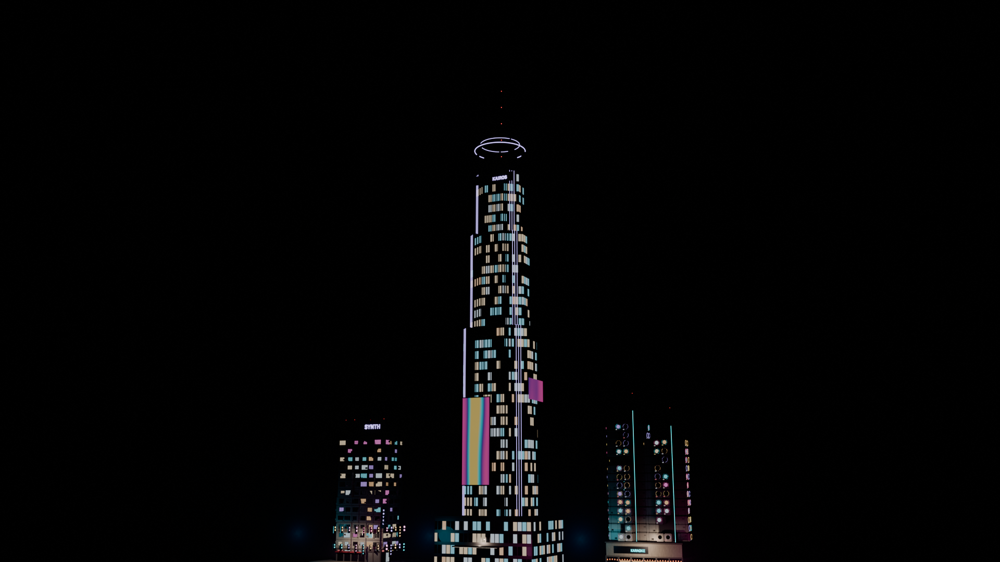
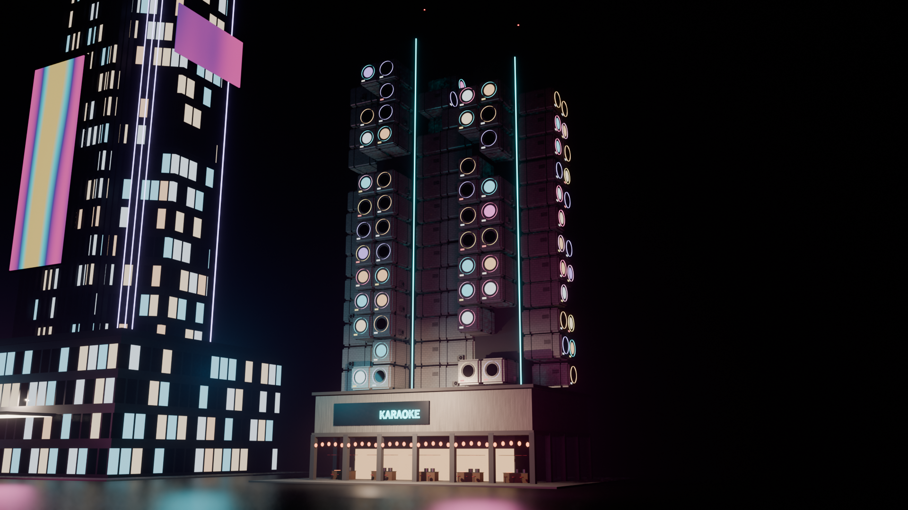

# NEON//DISTRICT: procedural cyberpunk buildings

Three procedural cyberpunk buildings, built twice:

- **in the browser** with React, TypeScript and native three.js (no React Three Fiber): a
  configurator on a wet neon street at night, with rain, reflections, bloom and animated signs;
- **in Blender 5.1** as Geometry Nodes, in `blender/CyberpunkBuildings.blend`, generated by
  the Python scripts in `blender/`.

Nothing is downloaded: geometry, materials, signs and lettering are all generated from a seed.
The design brainstorm (every element and where it is used) is in [DESIGN.md](DESIGN.md).

| | HIVE | ARCOLOGY | CAPSULE |
| --- | --- | --- | --- |
| Idea | Kowloon-style residential megablock | Megacorp HQ tower | Metabolist capsule tower on a night-market podium |
| Hero detail | cantilevered room stacks, AC units, cages, laundry, stacked kanji blade signs, corner neon | chamfered setbacks, office curtain wall, chasing LED corners, animated ad screens, glass elevators, hologram, halo crown, helipad | porthole pods with tiny rooms, neon rings, sky bridges, rotating cube sign, food stalls, lanterns, neon fascia words |



## Web app

```sh
npm install
npm run dev        # http://localhost:5190
```

| Key | |
| --- | --- |
| `1` `2` `3` | HIVE / ARCOLOGY / CAPSULE |
| `4` | ALL 3: the three buildings side by side |
| `R` | new random seed |
| `H` | hide the UI (clean captures) |
| `P` | save a PNG of the current frame |
| `O` | auto-orbit |
| `T` | Improved textures on / off |
| `Shift+T` | shuffle the texture sets |

URL parameters: `?type=capsule` (`hive`, `arcology`, `capsule`, `lineup`), `?seed=42`, `?palette=Toxic` (`Kabukicho`, `Toxic`, `Amber`, `Vapor`),
`?shot=street` (`hero`, `street`, `worm`, `detail`, `roof`, `aerial`), `?ui=0`.

**Style options** (per building, with a **Random style** button for instant variations):

- HIVE: cantilever depth, stack runs, tile variety, window type, cages, laundry, sign tiers, blade-sign style, corner neon, LED ticker, billboard type, roof shacks, water tanks, antennas.
- ARCOLOGY: number of setbacks, setback depth, chamfer, podium floors, fin rhythm, plant-floor rhythm, corner LEDs (chasing / steady / off), ad screens, crown style, spire, helipad, glass elevators, hologram.
- CAPSULE: pod density, dark pods, neon rings, pod jitter, core height gap, bridge spacing, food stalls, lanterns, menu boards, core neon sign, rotating cube sign.

**Improved textures** (the button under the title, or `T`; on by default): switches every
surface from the procedural materials to real PBR scans: 29 sets in 12 families (concrete,
plaster, mosaic tiles, brick, dark / brushed / rusty / painted metal, corrugated steel, asphalt,
paving, a yellow tactile strip along the curb) plus rain-streak grime down the walls.
**⟳ Shuffle textures** (`Shift+T`) rolls other sets for every surface; the seed also picks
them, so every reroll is a different building. Tinting keeps each material's palette, and the
models have no UVs, so each set is projected along the wall (u along the facade, v up) with its
colour, normal and roughness map. The sets (5.9 MB) load with the preloader; switching and
shuffling only rebind textures, so both are instant.

All textures are **CC0** (public domain) from [ambientCG](https://ambientcg.com) and
[Poly Haven](https://polyhaven.com): free for commercial use, no attribution required. The list
with links is in [public/tex/CREDITS.txt](public/tex/CREDITS.txt).
`python tools/prep_textures.py <ambientCG folder> <Poly Haven folder>` rebuilds `public/tex/` and
`src/gen/texManifest.ts` from the source sets.

**Editable text**: hover any sign, neon, ticker or ad screen and it gets a cyan outline; click it to edit
the text in place. Neon tube signs take A-Z, 0-9 and - / ! < > ♥; drawn signs take any text,
kanji and kana included. Edits are listed under **Text** in the panel, with reset buttons.

The panel also has structure sliders per building, detail density (signs, AC units, clutter, cables),
the neon palette, neon power and lit-window ratio, rain (off by default) / wetness / fog / bloom (off by default) / grain / AO,
camera shots, auto-orbit and letterbox.

### How it works

| | file |
| --- | --- |
| geometry accumulator: thousands of parts merged into one mesh per material | [src/gen/builder.ts](src/gen/builder.ts) |
| procedural materials: tile / panel / ribbed / corrugated patterns, grime streaks, bump, rain wetness; **interior-mapped rooms** behind every window (walls, ceiling lamp, furniture and people silhouettes, blinds, TV flicker); flickering neon | [src/gen/materials.ts](src/gen/materials.ts) |
| single-stroke neon font bent into 3D glass tubes | [src/gen/neonfont.ts](src/gen/neonfont.ts) |
| canvas-drawn kanji blade signs and lightboxes, LED tickers, animated ad screens, holograms, light spill | [src/gen/signs.ts](src/gen/signs.ts) |
| prop kit: AC units, water tanks, dishes, antennas, pipes, cables, cages, laundry, vents, vending machines, shutters, awnings, lanterns, Tokyo-style utility poles (crossarms, insulators, transformers, a lamp arm over the road) | [src/gen/props.ts](src/gen/props.ts) |
| the three buildings | [hive.ts](src/gen/hive.ts), [arcology.ts](src/gen/arcology.ts), [capsule.ts](src/gen/capsule.ts) |
| street: wet asphalt with blurred planar reflections, puddles, rain ripples, tiles, markings; utility poles round the block and an outer ring on the far side of every street, wired pole to pole, across the streets and into the building | [src/engine/stage.ts](src/engine/stage.ts), [src/engine/reflect.ts](src/engine/reflect.ts) |
| preloader: a skyline whose windows light up with real progress (fonts, generating, compiling shaders); the other building types compile in the background after the reveal | [src/ui/Preloader.tsx](src/ui/Preloader.tsx) |
| sky, rain (ported from RainSystemThreeJS), steam, post (GTAO, bloom, film grade); past the outer ring of poles the ground is an open plane | [src/engine/](src/engine/) |

## Deploying (Cloudflare)

The app is static: `npm run build` writes it to `dist/`, and it's hosted on Cloudflare as a
Worker with static assets. [wrangler.jsonc](wrangler.jsonc) points Cloudflare at `dist/` (the
Worker is named `neon-district`, any unknown path serves the app), and
[public/_headers](public/_headers) caches the hashed JS, CSS and font files for a year.

```bash
npx wrangler login     # once: connects wrangler to your Cloudflare account
npm run cf:dev         # build, then serve dist/ the way Cloudflare will, on localhost:8787
npm run deploy         # build, then upload; prints the *.workers.dev URL
```

To use your own domain, add a route or custom domain to the Worker in the Cloudflare
dashboard (Workers & Pages → neon-district → Settings → Domains & Routes).

## Blender (Geometry Nodes)

`blender/CyberpunkBuildings.blend` holds the three buildings side by side (the file opens on all three, through the lineup camera), each an object with a
Geometry Nodes modifier whose inputs are the controls:

- **CP_Hive**: Floors, Bays X / Y, Seed, AC Density, Sign Density, Cantilever, Cage Density, Corner Sign.
  Four calls of **CP_HiveFacade** (module grid, cantilever per vertical run, picked window kits,
  cages, AC units, slab bands, pipes, shopfronts, blade signs), plus roof kit scatter, a corner
  neon sign and a rooftop billboard.
- **CP_Arcology**: Floors, Width, Depth, Setback, Seed, Corp Name. Podium, three octagonal
  segments with floor slabs, fins and LED corners, screens, crown with halo rings, spire and beacons.
- **CP_Capsule**: Pod Floors, Two Cores, Pod Density, AC Density, Seed, Podium Sign. Night-market
  podium (stalls, lanterns, neon word), cores with **CP_PodFace** pods on every face, sky bridges.
- **CP_NeonText** (String to Curves bent into tubes) and **CP_BladeSign** are shared.

Kit meshes (AC unit, windows, cage, shopfronts, roof props, pod, stall, lantern) are modelled once
by `cp_kit.py`; all placement and variation is in the node trees.

Rebuild the .blend (and optionally render the stills into `docs/blender/`):

```powershell
& "C:\Program Files\Blender Foundation\Blender 5.1\blender.exe" --background --factory-startup `
  --python blender\build_cyberpunk.py -- --render --samples 32
```

| HIVE | ARCOLOGY | CAPSULE |
| --- | --- | --- |
|  |  |  |

## License

The project (code, Blender scripts, the neon font and everything generated) is
[MIT](LICENSE): use it, change it and ship it, commercially too, as long as the copyright
notice and license text come along.

Third-party parts keep their own (all permissive, all fine for commercial use):

| | license |
| --- | --- |
| Textures in `public/tex/` (ambientCG, Poly Haven) | CC0 1.0, public domain ([credits](public/tex/CREDITS.txt)) |
| Fonts: Noto Sans JP, Orbitron, Rajdhani (via Fontsource) | SIL Open Font License 1.1 |
| three.js, React | MIT |

